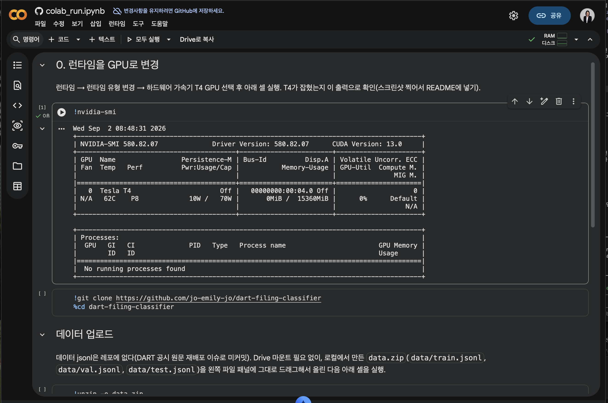

# dart-filing-classifier

DART(전자공시) 공시 **본문 텍스트 → 공시 유형(라벨)** 분류기. 데이터셋
빌더(`build_dataset.py`/`split.py`)와 `klue/roberta-base` 파인튜닝 파이프라인
(`train.py`/`evaluate.py`/`baseline_keyword.py`/`predict.py`/`llm_compare.py`)
으로 구성된다. `dart-alert-bot`에서 분리해 나온 독립 프로젝트다(이 폴더는
`dart_alert_bot.py`/`lead_radar.py`를 import하지 않는다 — 필요한 DART 호출
로직은 `dart_io.py`에 자체 복사되어 있다).

## 왜 만들었나

`dart-alert-bot`은 `report_nm`(공시 제목) 키워드 매칭으로 알림 대상을
고른다. 이 방식은 제목이 정형화된 "단일판매·공급계약체결", "유상증자결정"
같은 유형은 잘 잡지만, **제목만으로는 성격을 알기 어려운 유형**—특히
"기타경영사항(자율공시)"나 "주요사항보고서" 하위 다양한 결정사항—은
키워드 필터를 계속 늘려도 놓치거나 오탐이 난다. 본문을 읽고 유형을
분류하는 모델이 있으면 제목 키워드에 의존하지 않고 더 일반적으로 공시를
분류/필터링할 수 있다.

## 라벨 (8종)

| 라벨 | 비고 |
|---|---|
| 단일판매ㆍ공급계약체결 | 공급계약/수주 공시 |
| 유상증자결정 | |
| 타법인주식및출자증권취득결정 | |
| 신규시설투자등 | |
| 자기주식취득결정 | |
| 주요사항보고서(전체) | 위 4종 외 "주요사항보고서(...)" 하위유형을 모두 묶은 catch-all (예: 전환사채권발행결정, 유형자산양수결정 등) |
| 기타경영사항(자율공시) | |
| 주식등의대량보유상황보고서 | 5% 보고 |

라벨은 `report_nm`(공시 제목)에서 결정론적으로 유도한다. 정정공시 접두
(`[기재정정]` 등), 공백, 문장부호(가운뎃점 변형) 차이를 흡수하고,
"주요사항보고서(유상증자결정)"처럼 래핑된 제목과 "유상증자결정"처럼
단독으로 나오는 제목을 같은 라벨로 합친다. 규칙은 `labels.py`의
`normalize_label()` 하나에 모아뒀고, 대표 케이스 5개에 대한 유닛테스트가
같은 파일에 있다(`python labels.py`로 실행).

## 라벨 누출(leakage) 방지

공시 본문은 첫 줄(또는 첫 문단)에 제목을 그대로 반복하는 경우가 많다
(예: `단일판매ㆍ공급계약체결\n1. 판매ㆍ공급계약 내용...`). 이걸 그대로
학습에 쓰면 모델이 본문 내용이 아니라 "첫 줄에 라벨 문자열이 있는지"만
배우게 된다. `build_dataset.py`의 `strip_leaked_title_line()`이 본문의
첫 줄을 검사해서, 원제목(괄호 앞부분 포함)이나 정규화된 라벨 문자열이
그대로 들어 있으면 그 줄을 제거한다.

## 데이터 통계

2026-09-02 최근 90일 기준 실행 결과 (총 1,500건, API 호출 2,113회, 약 16분):

| 라벨 | 건수 | 평균 길이(자) | 버림(짧음/원문실패) |
|---|---:|---:|---:|
| 단일판매ㆍ공급계약체결 | 250 | 886 | 0 / 0 |
| 유상증자결정 | 247 | 1416 | 0 / 3 |
| 타법인주식및출자증권취득결정 | 250 | 1435 | 0 / 0 |
| 신규시설투자등 | 100 | 857 | 0 / 0 |
| 자기주식취득결정 | 128 | 1500 | 0 / 0 |
| 주요사항보고서(전체) | 235 | 1447 | 0 / 15 |
| 기타경영사항(자율공시) | 40 | 650 | 29 / 0 |
| 주식등의대량보유상황보고서 | 250 | 1500 | 0 / 0 |

- 신규시설투자등/자기주식취득결정/기타경영사항(자율공시)은 250건에 못
  미친다 — 최근 90일 안에 실제로 그만큼 없었거나(자기주식취득결정은
  corp_code 20% 캡에도 걸림), 기타경영사항(자율공시)은 본문이 짧아
  300자 미만으로 버려진 건이 많았다(29건 버림/후보 69건 중).
- train/val/test = 1199/151/150, 라벨별 비율도 80/10/10에 근접, corp
  그룹 누출 0건 (자세한 라벨별 분할 수는 `data/split_stats.md` 참고).
- 자세한 라벨별 통계는 `data/stats.md` 참고.

## 재현 방법 — 데이터셋

```bash
pip install -r requirements.txt
# .env에 DART_API_KEY 필요 (OpenDART 발급키)
python build_dataset.py   # data/filings.jsonl, stats.md 생성
python split.py            # data/train.jsonl, val.jsonl, test.jsonl, split_stats.md 생성
python labels.py -v         # normalize_label() 유닛테스트
```

`data/*.jsonl`은 커밋하지 않는다(DART 공시 원문 재배포 이슈). 위 스크립트로
언제든 재현 가능하다.

## 데이터 스키마

`filings.jsonl` (한 줄 = 한 공시):

```json
{
  "rcept_no": "20260828900123",
  "corp_name": "회사명",
  "rcept_dt": "20260828",
  "label": "단일판매ㆍ공급계약체결",
  "text": "본문 앞부분 최대 1500자 (제목 노출 첫 줄 제거됨)"
}
```

## 샘플링 방법

- 최근 90일을 7일 단위로 나눠 `list.json`을 페이지 끝까지 순회.
- 라벨별 최대 250건, `rcept_dt` 기준으로 고르게 뽑는다(균등 인덱스 샘플링).
- 한 회사(`corp_code`)가 라벨의 20%(최대 50건)를 넘지 못하게 캡.
- 본문 300자 미만이면 버린다(원문 조회 실패 포함).

## 학습 파이프라인

`klue/roberta-base`를 8라벨 분류로 파인튜닝한다. Colab T4(cuda)에서 정식
학습을 돌리고, 로컬에서는 `--smoke`로 32건·1epoch만 실행해 코드 경로만
확인한다(디바이스는 `cuda > mps > cpu` 순 자동 선택, mps/cpu에서도 --smoke
없이 그대로 도는 코드다 — 느릴 뿐이다). 로컬 macOS(M-series, mps)에서
`train.py --smoke` → `evaluate.py` → `baseline_keyword.py` → `predict.py`
전체 경로를 실제로 실행해 확인했다(아래 "로컬 스모크 실행 로그" 참고).

| 파일 | 역할 |
|---|---|
| `train.py` | 파인튜닝. best 체크포인트(`out/best_model`)와 학습곡선(`out/curves.png`) 저장 |
| `evaluate.py` | test셋 accuracy/macro-F1/라벨별 precision·recall, confusion matrix(`out/confusion.png`) → `out/metrics.json` |
| `baseline_keyword.py` | `dart_alert_bot.py`의 제목 키워드 7종을 본문에 적용한 규칙 베이스라인 + "제목 필터가 자율공시·주요사항보고서(전체) 라벨 안의 공급계약성 공시를 얼마나 놓쳤을지" 계산. 같은 `out/metrics.json`에 병합 |
| `predict.py` | `rcept_no` 하나를 받아 본문을 크롤링해 라벨 top-3 확률 출력 |
| `llm_compare.py` | EXAONE-3.5-2.4B-Instruct(실패 시 Qwen2.5-1.5B-Instruct)로 공급계약 공시 5건을 3줄 요약, 로드시간/VRAM/생성시간을 `out/llm_compare.md`에 기록. 무거운 생성형 비교라 Colab 전용(로컬 스모크 대상 아님) |

`evaluate` 라이브러리는 쓰지 않는다 — 평가 스크립트 파일명이 `evaluate.py`라서
같은 폴더에서 `import evaluate`를 하면 pip 패키지 대신 이 파일 자신이
잡히기 때문에(스크립트 실행 시 그 디렉터리가 `sys.path[0]`이 됨), 대신
scikit-learn으로 동일한 지표(accuracy/macro-F1)를 계산한다.

### 재현 방법 — 학습(Colab)

`notebooks/colab_run.ipynb`을 Colab에 업로드해서 위에서부터 순서대로
실행한다. Drive 마운트는 필요 없다 — 데이터는 로컬 `data.zip`을 Colab
파일 패널에 직접 올리는 게 제일 빠르다.

1. 런타임 → 런타임 유형 변경 → T4 GPU 선택
2. `!nvidia-smi`로 T4 잡혔는지 확인 (스크린샷 찍어서 아래에 넣기)
3. `!git clone https://github.com/jo-emily-jo/dart-filing-classifier && cd dart-filing-classifier`
4. 로컬에서 `data.zip`(`data/train.jsonl`, `val.jsonl`, `test.jsonl`; `zip -q data.zip data/train.jsonl data/val.jsonl data/test.jsonl`로 생성)을 파일 패널에 업로드 → `!unzip -o data.zip`
5. `!pip install -r requirements-train.txt` (torch는 Colab에 이미 GPU에
   맞게 깔려있어서 일부러 이 파일에 안 넣었다 — 여기서 다른 torch를
   깔면 torchvision/torchaudio 짝이 깨져서 `from transformers import
   Trainer`가 죽는다. 혹시 이전에 torch를 따로 설치해서 이미 깨졌다면
   `!pip uninstall -y torchvision torchaudio -q`로 복구)
6. `!python train.py --fp16 --epochs 3 --out out`
7. (선택) `!apt-get -qq install -y fonts-nanum`로 한글 폰트를 깔면
   `confusion.png` 라벨이 네모로 안 깨진다 — 안 깔아도 `evaluate.py`
   자체는 정상 동작(수치는 영향 없음, 그림 폰트만 다름)
8. `!python evaluate.py`
9. `!python baseline_keyword.py`
10. `!python llm_compare.py`

**T4 확인 스크린샷:**



로컬(mps/cpu)에서 코드 경로만 확인할 때는 `--smoke`를 쓴다(정식 학습은
위 Colab 순서대로):

```bash
python3 -m venv venv && source venv/bin/activate
pip install torch   # 로컬은 Colab과 달리 torch가 없으니 따로 설치
pip install -r requirements.txt -r requirements-train.txt
python train.py --smoke   # 32건·1epoch, 코드 경로 확인용
python evaluate.py --model_dir out/best_model
python baseline_keyword.py
python predict.py <rcept_no>
```

### 결과 (TBD — Colab 정식 학습 후 채울 것)

| 모델 | GPU | 학습시간 | macro-F1 | 키워드 베이스라인 macro-F1 |
|---|---|---:|---:|---:|
| klue/roberta-base | T4 | - | - | - |

- 라벨별 precision/recall, confusion matrix: `out/metrics.json`, `out/confusion.png`
- "제목 키워드 필터가 놓쳤을 비율": `out/metrics.json`의 `title_keyword_filter_miss`
- LLM 요약 비교(로드시간/VRAM/생성시간): `out/llm_compare.md`

### 로컬 스모크 실행 로그 (2026-09-02, MacBook Air M-series, mps)

- `train.py --smoke`: train/val/test 각 32건, 1epoch, 약 6~7분(모델 최초
  다운로드 포함 시 더 오래 걸림). `out/best_model`, `out/curves.png` 정상 저장.
- `evaluate.py`: 정상 실행 (32건짜리 스모크 모델이라 accuracy≈0.03으로
  낮음 — 예상된 결과, 코드 경로 확인이 목적).
- `baseline_keyword.py`: 정상 실행. 스모크 test 150건 기준 본문 키워드
  규칙 베이스라인 accuracy=0.393, macro_f1=0.351이었고, "주요사항보고서
  (전체)" 라벨 23건 중 4건(17.4%)이 본문에 공급계약 신호를 갖고 있어
  제목 키워드 필터였다면 완전히 놓쳤을 것으로 확인됨(이 프로젝트의
  동기를 데이터로 뒷받침).
- `predict.py`: 실제 rcept_no로 DART 원문을 크롤링해 top-3 라벨 확률 출력
  정상 동작 확인.
- `llm_compare.py`: 구문 검사·import만 확인(2.4B 모델 다운로드는 로컬
  디스크/시간 제약으로 스킵 — Colab에서 실행 권장).
