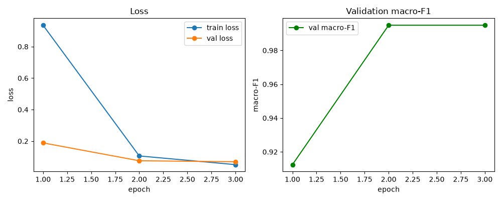
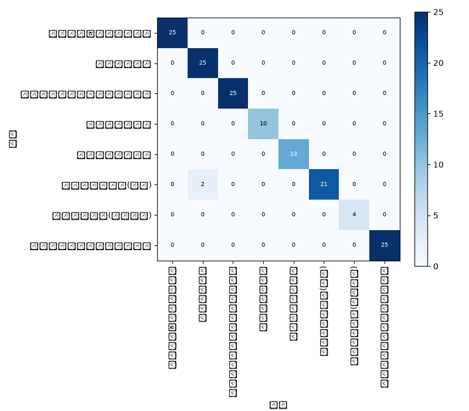

# dart-filing-classifier

A classifier that maps DART (Korea's electronic disclosure system) filing
**body text → filing type (label)**. Consists of a dataset builder
(`build_dataset.py`/`split.py`) and a `klue/roberta-base` fine-tuning
pipeline (`train.py`/`evaluate.py`/`baseline_keyword.py`/`predict.py`/
`llm_compare.py`). Split out as an independent project from `dart-alert-bot`
(this repo does not import `dart_alert_bot.py`/`lead_radar.py` — the DART
API logic it needs is copied into its own `dart_io.py`).

## Why this exists

`dart-alert-bot` picks alert targets by keyword-matching on `report_nm`
(the filing title). That works well for filing types with a standardized
title — "단일판매·공급계약체결" (supply contract), "유상증자결정" (capital
increase) — but **filing types whose nature isn't obvious from the title
alone** — especially "기타경영사항(자율공시)" (voluntary disclosure) and the
many subtypes under "주요사항보고서" (material fact report) — keep getting
missed or false-matched no matter how many keywords you add. A model that
reads the body and classifies the type can filter/classify filings more
generally, without depending on title keywords.

## Labels (8)

| Label | Note |
|---|---|
| 단일판매ㆍ공급계약체결 | single-sale/supply contract |
| 유상증자결정 | paid-in capital increase |
| 타법인주식및출자증권취득결정 | acquisition of another company's shares/equity |
| 신규시설투자등 | new facility investment |
| 자기주식취득결정 | treasury stock acquisition |
| 주요사항보고서(전체) | catch-all for every "주요사항보고서(...)" subtype other than the 4 above (e.g. convertible bond issuance, tangible asset acquisition) |
| 기타경영사항(자율공시) | other management matters (voluntary disclosure) |
| 주식등의대량보유상황보고서 | 5%-ownership report |

Labels are derived deterministically from `report_nm` (the filing title).
The normalization absorbs amendment prefixes (`[기재정정]` etc.), whitespace,
and punctuation variants (middle-dot forms), and merges a title wrapped as
"주요사항보고서(유상증자결정)" with the same title appearing bare as
"유상증자결정" into one label. The rule lives in a single function,
`normalize_label()` in `labels.py`, with 5 unit tests covering the
representative cases in the same file (run with `python labels.py -v`).

## Label leakage prevention

Filing bodies often repeat the title verbatim in the first line (or
paragraph) — e.g. `단일판매ㆍ공급계약체결\n1. 판매ㆍ공급계약 내용...`. Training
on that as-is would let the model learn "does the first line contain the
label string" instead of the actual content. `build_dataset.py`'s
`strip_leaked_title_line()` inspects the body's first line and removes it
if it contains the original title (including the pre-parenthesis part) or
the normalized label string verbatim.

## Dataset stats

Run on 2026-09-02 over the most recent 90 days (1,500 filings total, 2,113
API calls, ~16 minutes):

| Label | Count | Avg length (chars) | Dropped (too short / fetch failed) |
|---|---:|---:|---:|
| 단일판매ㆍ공급계약체결 | 250 | 886 | 0 / 0 |
| 유상증자결정 | 247 | 1416 | 0 / 3 |
| 타법인주식및출자증권취득결정 | 250 | 1435 | 0 / 0 |
| 신규시설투자등 | 100 | 857 | 0 / 0 |
| 자기주식취득결정 | 128 | 1500 | 0 / 0 |
| 주요사항보고서(전체) | 235 | 1447 | 0 / 15 |
| 기타경영사항(자율공시) | 40 | 650 | 29 / 0 |
| 주식등의대량보유상황보고서 | 250 | 1500 | 0 / 0 |

- 신규시설투자등/자기주식취득결정/기타경영사항(자율공시) fall short of 250 —
  either there genuinely weren't that many in the last 90 days
  (자기주식취득결정 also hit the corp_code 20% cap), or in the case of
  기타경영사항(자율공시) many bodies were too short and got dropped (29
  dropped out of 69 candidates).
- train/val/test = 1199/151/150, per-label ratios close to 80/10/10, zero
  corp-group leakage (see `data/split_stats.md` for the per-label split
  breakdown).
- Full per-label stats: `data/stats.md`.

## Reproducing — dataset

```bash
pip install -r requirements.txt
# needs DART_API_KEY in .env (issued via OpenDART)
python build_dataset.py   # produces data/filings.jsonl, stats.md
python split.py            # produces data/train.jsonl, val.jsonl, test.jsonl, split_stats.md
python labels.py -v         # normalize_label() unit tests
```

`data/*.jsonl` is not committed (DART filing-text redistribution concern).
It's always reproducible via the scripts above.

## Data schema

`filings.jsonl` (one line = one filing):

```json
{
  "rcept_no": "20260828900123",
  "corp_name": "company name",
  "rcept_dt": "20260828",
  "label": "단일판매ㆍ공급계약체결",
  "text": "first up to 1,500 chars of the body (leaked title line stripped)"
}
```

## Sampling method

- Walk `list.json` to the last page over 7-day windows across the last 90 days.
- Up to 250 filings per label, sampled evenly by `rcept_dt` (evenly spaced
  index sampling).
- Cap: a single company (`corp_code`) can't exceed 20% (max 50) of a
  label's quota.
- Drop any filing whose body is under 300 characters (including fetch
  failures).

## Training pipeline

Fine-tunes `klue/roberta-base` for 8-label classification. Full training
runs on a Colab T4 (cuda); locally, `--smoke` runs just 32 examples for 1
epoch to verify the code path only (device auto-selects `cuda > mps > cpu`,
and the code runs fine on mps/cpu without `--smoke` too — just slowly). The
full local path `train.py --smoke` → `evaluate.py` → `baseline_keyword.py`
→ `predict.py` was actually run and verified on a local macOS machine
(M-series, mps) — see "Local smoke-test log" below.

| File | Role |
|---|---|
| `train.py` | Fine-tuning. Saves the best checkpoint (`out/best_model`) and the training curves (`out/curves.png`) |
| `evaluate.py` | test-set accuracy/macro-F1/per-label precision & recall, confusion matrix (`out/confusion.png`) → `out/metrics.json` |
| `baseline_keyword.py` | A rule-based baseline applying `dart_alert_bot.py`'s 7 title keywords to the body text, plus a calculation of how much a title-only filter would have missed within the 자율공시/주요사항보고서(전체) labels. Merges into the same `out/metrics.json` |
| `predict.py` | Takes one `rcept_no`, crawls the body, and prints the top-3 predicted labels with probabilities |
| `llm_compare.py` | Summarizes 5 supply-contract filings in 3 lines using EXAONE-3.5-2.4B-Instruct (falls back to Qwen2.5-1.5B-Instruct on failure), logging load time/VRAM/generation time to `out/llm_compare.md`. A heavy generative comparison meant for Colab (not part of the local smoke test) |

The `evaluate` pip library is intentionally unused — since the evaluation
script is named `evaluate.py`, `import evaluate` from anywhere in this
directory would resolve to that file instead of the pip package (the
script's own directory becomes `sys.path[0]`). scikit-learn is used
instead to compute the same metrics (accuracy/macro-F1).

### Reproducing — training (Colab)

Upload `notebooks/colab_run.ipynb` to Colab and run the cells top to
bottom. No Drive mount needed — the fastest way to get the data in is to
zip it locally and drag it straight into Colab's file panel.

1. Runtime → Change runtime type → select T4 GPU
2. `!nvidia-smi` to confirm the T4 is attached (screenshot below)
3. `!git clone https://github.com/jo-emily-jo/dart-filing-classifier && cd dart-filing-classifier`
4. Build `data.zip` locally (`data/train.jsonl`, `val.jsonl`, `test.jsonl`;
   `zip -q data.zip data/train.jsonl data/val.jsonl data/test.jsonl`),
   upload it via the file panel, then `!unzip -o data.zip`
5. `!pip install -r requirements-train.txt` (torch is deliberately left
   out of this file — Colab already ships one matched to its GPU/CUDA.
   Installing a different torch here breaks the torchvision/torchaudio
   pairing and crashes `from transformers import Trainer`. If you already
   broke it by installing torch separately, recover with
   `!pip uninstall -y torchvision torchaudio -q`)
6. `!python train.py --fp16 --epochs 3 --out out`
7. (optional) `!apt-get -qq install -y fonts-nanum` installs a Korean
   font so `confusion.png` labels don't render as tofu boxes — skipping
   this doesn't affect `evaluate.py`'s actual numbers, just the plot font
8. `!python evaluate.py`
9. `!python baseline_keyword.py`
10. `!python llm_compare.py`

**T4 confirmation screenshot:**


To just verify the code path locally (mps/cpu) — use `--smoke` (full
training follows the Colab steps above):

```bash
python3 -m venv venv && source venv/bin/activate
pip install torch   # unlike Colab, torch isn't preinstalled locally
pip install -r requirements.txt -r requirements-train.txt
python train.py --smoke   # 32 examples, 1 epoch, code-path check only
python evaluate.py --model_dir out/best_model
python baseline_keyword.py
python predict.py <rcept_no>
```

### Results (2026-09-02, Colab T4, `train.py --fp16 --epochs 3 --out out`)

| Model | GPU | Training time | Test accuracy | Test macro-F1 | Keyword baseline macro-F1 |
|---|---|---:|---:|---:|---:|
| klue/roberta-base | T4 | 122.6s (3 epochs) | 0.9867 | 0.9895 | 0.3511 |

Training curves:



The keyword baseline (the 7 title keywords applied to the body) scores
accuracy 0.3933, macro-F1 0.3511 — a huge gap versus the fine-tuned model.
Only 67 of the 150 test filings matched any keyword at all (the rest
weren't even classifiable by this method).

Per-label precision/recall/f1 (test, n=150):

| Label | precision | recall | f1 | support |
|---|---:|---:|---:|---:|
| 단일판매ㆍ공급계약체결 | 1.000 | 1.000 | 1.000 | 25 |
| 유상증자결정 | 0.926 | 1.000 | 0.962 | 25 |
| 타법인주식및출자증권취득결정 | 1.000 | 1.000 | 1.000 | 25 |
| 신규시설투자등 | 1.000 | 1.000 | 1.000 | 10 |
| 자기주식취득결정 | 1.000 | 1.000 | 1.000 | 13 |
| 주요사항보고서(전체) | 1.000 | 0.913 | 0.955 | 23 |
| 기타경영사항(자율공시) | 1.000 | 1.000 | 1.000 | 4 |
| 주식등의대량보유상황보고서 | 1.000 | 1.000 | 1.000 | 25 |

The only two labels that slip (유상증자결정 precision 0.926, 주요사항보고서
(전체) recall 0.913) appear to be confused with each other — likely because
"주요사항보고서(전체)" is a catch-all lumping together many subtypes
including capital-increase-adjacent ones, so the boundary with 유상증자결정
blurs (an overlap that's inherent to how the label is defined).

Confusion matrix:



Raw numbers: [`results/metrics.json`](results/metrics.json).

**How much a "title keyword filter" would actually have missed**
(`title_keyword_filter_miss` — the data backing this project's motivation):

| Label | Total | Supply-contract signal in body | Estimated miss rate |
|---|---:|---:|---:|
| 기타경영사항(자율공시) | 4 | 0 | 0.0% |
| 주요사항보고서(전체) | 23 | 4 | 17.4% |

In other words, 17.4% of filings labeled "주요사항보고서(전체)" have
supply-contract-like content in the body, yet a title-only keyword filter
(the `dart_alert_bot.py` approach) would have missed them entirely.

**LLM summarization comparison** (full text:
[`results/llm_compare.md`](results/llm_compare.md)):
`LGAI-EXAONE/EXAONE-3.5-2.4B-Instruct` loaded successfully but failed at
the generation step because its custom remote code (`create_causal_mask`)
doesn't match the installed transformers version (`input_embeds` vs
`inputs_embeds` — EXAONE's code was written against an older transformers
API); the fallback logic correctly kicked in and switched to
`Qwen/Qwen2.5-1.5B-Instruct`. Qwen's load time was 133.1s, VRAM 8.00GB
(likely inflated by leftover allocation from the failed EXAONE attempt,
so probably higher than Qwen's actual standalone usage), and generation
took 2.9–8.2s per filing. All 5 supply-contract filings were summarized
reasonably (contract amount/counterparty/period), without fabricating
numbers absent from the source text.

### Local smoke-test log (2026-09-02, MacBook Air M-series, mps)

- `train.py --smoke`: 32 examples each for train/val/test, 1 epoch, ~6-7
  minutes (longer if it has to download the model first). `out/best_model`
  and `out/curves.png` saved correctly.
- `evaluate.py`: ran cleanly (accuracy≈0.03 since the smoke model only saw
  32 examples — expected, the point was just to verify the code path).
- `baseline_keyword.py`: ran cleanly. On the smoke run's 150 test
  examples, the body-keyword rule baseline scored accuracy=0.393,
  macro_f1=0.351, and 4 of 23 "주요사항보고서(전체)"-labeled filings (17.4%)
  had supply-contract signal in the body — confirming a title-only keyword
  filter would have missed them entirely (the data backing this project's
  motivation).
- `predict.py`: confirmed working end-to-end — crawls a real filing body
  by `rcept_no` and prints the top-3 label probabilities.
- `llm_compare.py`: syntax/import-checked only (skipped the actual 2.4B
  model download locally due to disk/time constraints — run on Colab
  instead).
